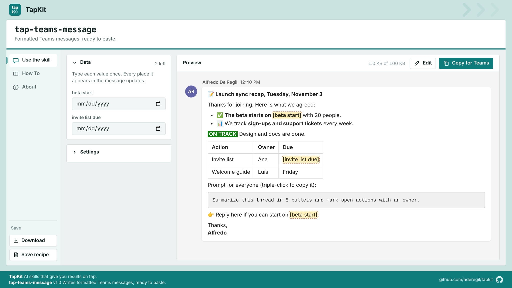

# TapKit

**AI skills that give you results on tap.**

TapKit is a collection of skills for Claude. You ask in plain words, and the skill gives you a finished result: a page you can open, check, adjust and use right away. Every TapKit skill name starts with `tap-`.

| Skill | What it gives you | Version |
|---|---|---|
| [tap-teams-message](skills/tap-teams-message) | Formatted Microsoft Teams messages, ready to paste | 1.0.0 |

More skills are on the way.

---

## tap-teams-message

Ask Claude for a Teams message, for example *"recap of today's call for the team chat"*. Claude writes it with real formatting (emoji, bold, colors, lists, tables, status chips, text to copy) and builds one page where you:

- **See it** as it will look in Teams.
- **Fill in the blanks** with the right control: date and time pickers, numbers, choices, images.
- **Turn parts on or off**: emoji, header, call to action, sign-off.
- **Edit** the text with a small formatting toolbar.
- **Copy for Teams** and paste it in any chat or channel.
- **Download** the page with your changes, or **save a recipe** so Claude writes the next one the same way.

The page works in English and Spanish.



---

## Install

### Claude (web and desktop app)

1. Download **[tap-teams-message.zip](https://github.com/aderegil/tapkit/releases/latest/download/tap-teams-message.zip)** from the latest release.
2. Make sure code execution is on: **Settings > Capabilities > Code execution and file creation**. On Team and Enterprise plans, an owner turns it on for the organization.
3. Go to **Customize > Skills**, select **+**, then **Create skill > Upload a skill**, and choose the zip.
4. Turn the skill on.

Ask for a Teams message in any chat. Claude uses the skill on its own.

### Claude Code

Add TapKit as a plugin marketplace, then install the skills you want:

```
/plugin marketplace add aderegil/tapkit
/plugin install tap-teams-message@tapkit
```

To get updates later: `/plugin marketplace update tapkit`.

### Manual copy (Claude Code and other tools that read Agent Skills)

Copy the folder `skills/tap-teams-message` into your skills folder, for example `~/.claude/skills/tap-teams-message` for Claude Code.

---

## Requirements

- Python 3 where Claude runs the skill. The build script uses only the standard library.
- To paste: Microsoft Teams (desktop, web or mobile) and a current browser to open the page.
- Optional, for checking pages: Playwright for Python (`scripts/check_page.py`).

## Repository layout

```
.claude-plugin/marketplace.json   TapKit marketplace for Claude Code
skills/<skill>/                   one folder per skill (SKILL.md, scripts, assets, references)
docs/images/                      screenshots for this page
tools/package_skills.py           builds dist/<skill>.zip for releases
```

## Release a new version

1. Update the skill and its version in `.claude-plugin/marketplace.json` and in `CHANGELOG.md`.
2. Run `python3 tools/package_skills.py`.
3. Create a GitHub release and attach `dist/<skill>.zip`.

---

Made by Alfredo De Regil. Licensed under [CC BY-ND 4.0](LICENSE): free to use and share unchanged, with credit; changed versions may not be shared.
